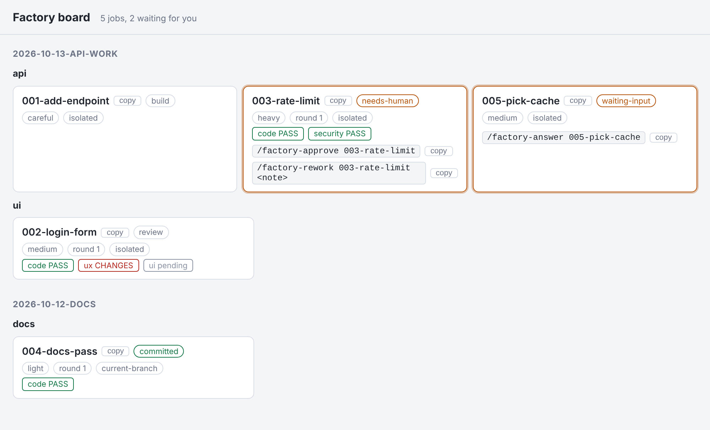
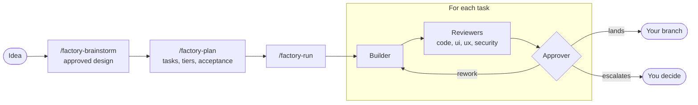

# clay-kit

Personal marketplace of plugins, skills and tools for Claude Code, Codex and Cursor.

**clay** takes an idea to reviewed, merged code. You design and plan with the model in a conversation.
Then every task is built, checked by the reviewers its change needs, and approved or handed back to you.

<picture>
  <source media="(prefers-color-scheme: dark)" srcset="docs/images/dashboard-dark.png">
  
</picture>

The clay dashboard, rendered from the test fixtures.

## How it works



- **Reviews by route.** Code review always runs. ui, ux and security join only when the changed paths call for them.
- **Tiers pick the model.** Light tasks run on a fast model, careful and heavy ones on a stronger one.
- **Your checkout stays clean.** The recommended setup is a development branch per plan with one worktree per job. Nothing is ever pushed.
- **You stay in charge.** After each task the run asks whether to go on. Escalations come to you with the choices ready.
- **One run per plan.** A lock stops a second run on the same plan and keeps the plan and its spec read-only.
- **Progress you can see.** A band and a pane inside Claude Code, a static dashboard on every host.
- **Plans you already have.** Plans follow the superpowers layout, so existing ones run without migration.

| Tool | What it does |
|------|--------------|
| [clay](plugins/clay) | From an idea to merged code: `/factory-brainstorm`, `/factory-plan`, then `/factory-run`, with routed review and approval. |

## Install

The marketplace is called `clay-kit` and the plugin `clay`.

### Claude Code

In Claude Code:

```
/plugin marketplace add swolley/clay-kit
/plugin install clay@clay-kit
```

Restart the session afterwards. Commands are named `factory-<verb>`, for example `/factory-run`; the namespaced form `/clay:factory-run` also works.

### Codex

In a terminal:

```
codex plugin marketplace add swolley/clay-kit
codex plugin add clay@clay-kit
```

Codex reads `.codex-plugin/plugin.json` for the plugin and the existing `.claude-plugin/marketplace.json` for the marketplace. Start a skill with `$factory-run`, or pick it from the `/skills` picker, where plugin skills are namespaced (`clay:factory-run`).

### Cursor

As documented by Cursor, not yet tried by us. In the Cursor CLI:

```
/plugin marketplace add https://github.com/swolley/clay-kit
```

For a team, an admin imports the repository from the Cursor Dashboard (Plugins & MCPs, Import from Repo), and users install it from Customize. Then type `/factory-run`.

Codex and Cursor are supported with limits (no progress band, different model names, a question fallback, and more); see the "Hosts" section of the [clay README](plugins/clay/README.md#hosts).

## Development

```bash
python3 -m venv .venv && .venv/bin/pip install pytest
.venv/bin/python -m pytest tests -q
.venv/bin/python scripts/validate.py
```

`scripts/typecheck-mod.sh <loaded copy of the mod>` type-checks the progress mod against the engine's own types (a missing
identifier in a render hook makes the engine skip the whole hook and draw nothing, and the static validation does not see it).
`node --test tests/mod/` runs the pure logic of the mod.
`node scripts/screenshots.mjs` renders the dashboard on the fixture jobs and refreshes the README previews in `docs/images/`
(needs `python3` and the `playwright` package).

`scripts/validate.py` checks manifests, skill and agent frontmatter, and the rules of the tool
(no dependency on other plugins, one style contract, invocation policy of each command).

## Layout and licenses

- `plugins/<tool>/`: one self-contained tool per folder.
- `docs/superpowers/specs/` and `plans/`: the design record, in the superpowers layout so projects built with that tool stay compatible.
- `LICENSE`: MIT, for this repository's own work. `licenses/`: texts and index of the third-party licenses; derived files are listed in each tool's `NOTICE.md`.
